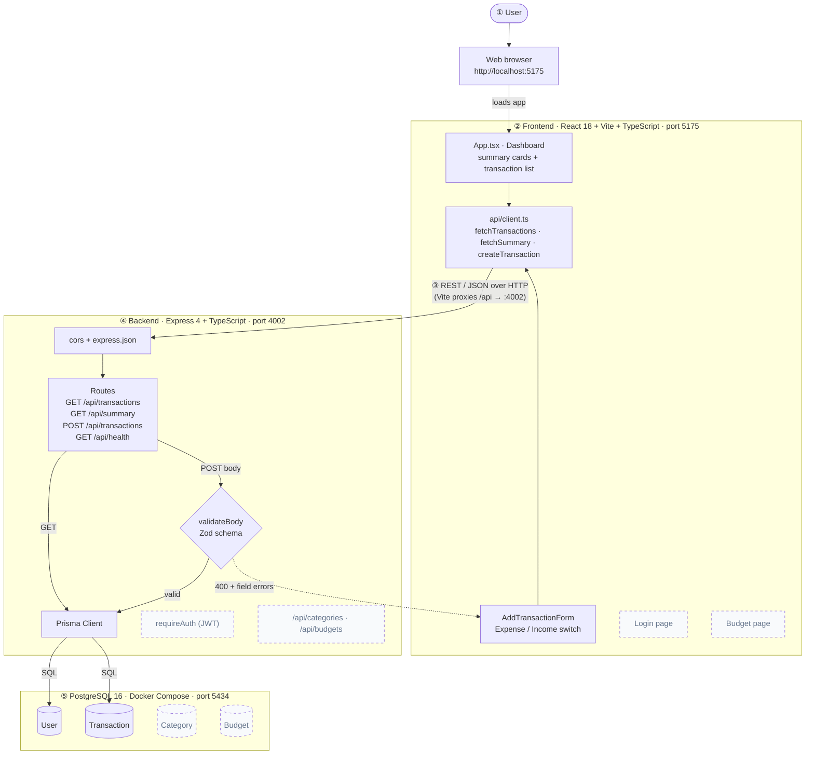
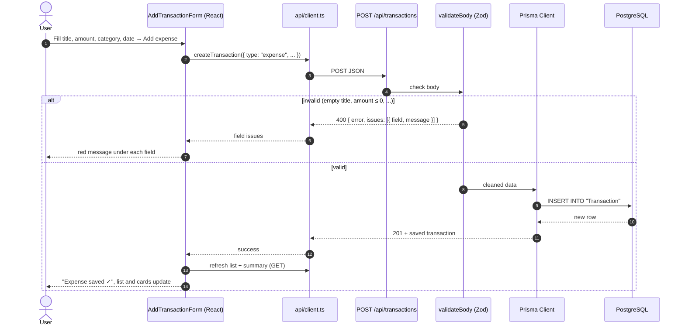
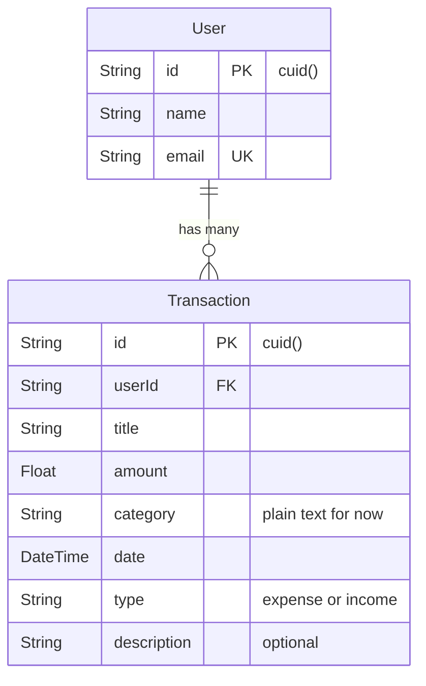
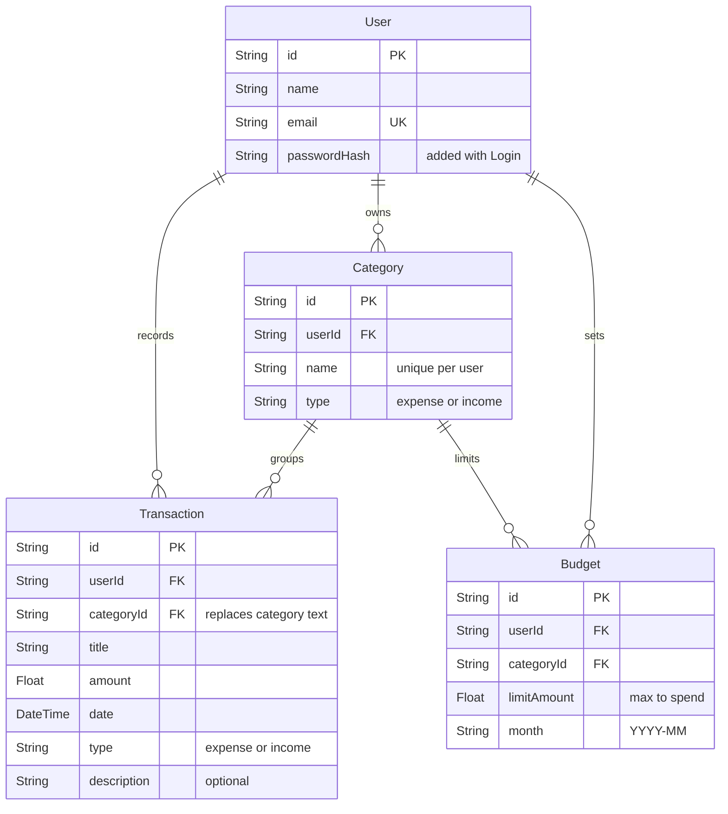

# Expense Tracker: Architecture and Schema

Team J (Max, Jovhems, Sharon) · CS 450 · Sprint 1

This page shows how the app is put together, how one request travels through it, and how the data is stored.
Boxes with a **dashed border** are planned for later sprints; solid boxes exist in the code today.
Our original hand-drawn sketch is in [architecture-sketch.pdf](architecture-sketch.pdf) (if present).

## 1. System architecture

| # | Layer | What it does | Key files |
| --- | --- | --- | --- |
| ① | User | Opens the app in a web browser | |
| ② | Frontend | React dashboard: summary cards, transaction list, and the Add a transaction form (expense or income) | `frontend/src/App.tsx`, `components/AddTransactionForm.tsx` |
| ③ | REST API / JSON | The frontend only talks to the backend through JSON over HTTP. In development, Vite forwards `/api` to port 4002 | `frontend/src/api/client.ts`, `frontend/vite.config.ts` |
| ④ | Backend | Express routes. `POST` bodies are checked by the Zod `validateBody` middleware first; bad input gets a `400` with a list of field errors and never reaches the database. Valid requests go through Prisma | `backend/src/index.ts`, `middleware/validateBody.ts`, `schemas/transaction.ts` |
| ⑤ | Database | PostgreSQL 16 running in Docker Compose, so every teammate has the same database on the same port | `docker-compose.yml`, `backend/prisma/schema.prisma` |

## 2. One request, step by step: adding an expense

Adding income is the same flow with `type: "income"`.

## 3. Database schema

### Current schema (Sprint 1, matches `backend/prisma/schema.prisma`)

### Target schema (next sprints)

What changes from current to target:
- **Category** becomes its own table, and `Transaction.category` (text) becomes `categoryId`, so names stay consistent and filters work by id.
- **Budget** stores a monthly spending limit per category (`month` like `2026-10`).
- **User** gets a `passwordHash` when Login is added.

## 4. Design decisions

| Decision | Why |
| --- | --- |
| TypeScript on both frontend and backend | One language across the stack; `tsc` catches mismatched data shapes before runtime |
| REST + JSON between frontend and backend | Simple, easy to test with `curl`, and the browser never talks to the database directly |
| Vite proxy for `/api` in development | The frontend calls `/api/...` with no hardcoded port or CORS issues |
| One `Transaction` table with a `type` field | Income and expenses have the same fields, so totals and net balance are simple queries |
| Zod validation as reusable middleware | Bad input is stopped before the database with clear `400` field errors the form can show |
| Prisma ORM with migrations | The schema lives in code and every change is a versioned migration in Git |
| PostgreSQL in Docker Compose | Same database version and port for everyone, nothing to install by hand |
| Every record belongs to a `User` | Ready for Login: each user will only see their own data. Until then a single demo user is used |
| Separate `Category` table (planned) | Avoids "Food" vs "food" typos; budgets and filters point to the same category |
| Jira key in every branch and PR title | Each change traces back to a backlog story |

## 5. Backlog stories this supports

| Story | How the architecture supports it | Status |
| --- | --- | --- |
| F26B-9 Add an expense | `POST /api/transactions` with `type: "expense"` + Add a transaction form | Sprint 1 |
| F26B-40 Add income | Same route and form with `type: "income"` | Sprint 1 |
| F26B-31 View transaction history | `GET /api/transactions` from PostgreSQL, shown in the list | Sprint 1 |
| F26B-41 View income, expense, and net balance | `GET /api/summary`, shown in the three cards | Sprint 1 |
| F26B-32 Edit a transaction | Add `PUT /api/transactions/:id` reusing the Zod schema | Next |
| F26B-5 / F26B-10 Track and filter by category | `Category` table + `categoryId` on Transaction | Next |
| F26B-42 Filter by date | `date` column, filter with query params | Next |
| F26B-7 View monthly summary | Group transactions by month in `/api/summary` | Next |
| F26B-8 View budget | `Budget` table + `/api/budgets` + Budget page | Next |